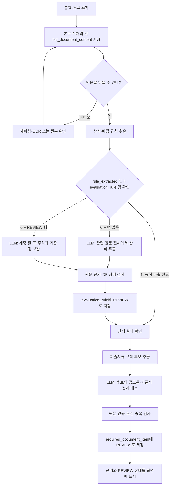

# 공고 분석 LLM 보완 실행 순서

현재 연결 대상은 SQLite `bidmate.sqlite3`다. 수집기가 본문 저장과 산식 규칙 추출까지 수행한다. 아래 명령은 프로젝트 루트에서 실행한다. `.env`의 `OPENAI_API_KEY`와 `OPENAI_MODEL`을 사용하며, `--execute`가 없는 명령은 API를 호출하지 않는다.

## 전체 흐름



수집 완료와 AI 분석 완료는 별개다. 산식 LLM은 현재 공고번호를 지정해 실행하며, 제출서류 LLM 대상도 현재는 별도로 선정한다. `REVIEW`는 자동 검증 또는 사람 확인이 더 필요하다는 뜻이다.

운영 DB가 정해지면 LLM 출력 형식과 저장 담당의 역할은 [LLM 연동 기준](LLM_HANDOFF.md)에 맞춰 연결한다.

## 1. 산식·배점 보완

`bid_document_content.rule_extracted=0`인 공고번호를 선택한다. 평가 행이 없으면 전체 관련 본문을 보내고, `REVIEW` 행이 있으면 해당 행 주변과 기존 배점표를 보낸다.

```powershell
python -m ai.llm_evaluation --notice 공고번호
python -m ai.llm_evaluation --notice 공고번호 --execute
python -m ai.llm_evaluation --notice 공고번호 --apply-draft .local/llm-evaluation/출력파일.json
```

두 번째 명령은 유료 호출 후 `.local/llm-evaluation/`에 검토용 JSON을 만든다. 출력된 `review_file` 경로를 세 번째 명령에 넣는다. 세 번째 명령은 API 재호출 없이 `evaluation_rule`에 `updated_by=LLM`, `verification_status=REVIEW`로 저장한다. 원문 근거가 없거나 입력 원문이 바뀌면 저장하지 않는다. 이미지에만 있는 산식·파싱에 실패한 본문은 OCR 또는 원본 판독이 선행돼야 한다.

## 2. 제출서류 규칙 후보 + LLM 보완

```powershell
python -m ai.document_staging ingest-db bidmate.sqlite3
python -m ai.llm_documents --notice 공고번호
python -m ai.llm_documents --notice 공고번호 --execute
python -m ai.document_staging migrate bidmate.sqlite3 --include-review
python -m ai.document_staging migrate bidmate.sqlite3 --include-review --apply
```

`llm_documents`가 해당 공고의 규칙 후보를 먼저 만들고, LLM은 후보와 공고문·기준서 전체를 함께 대조해 누락을 찾는다. 규칙 후보가 있다는 사실만으로 추출 완료를 판정할 수 없으므로, LLM 검증 대상 공고는 별도로 선정해야 한다. `migrate`의 첫 명령은 미리보기이고 `--apply`를 붙여야 `required_document_item`에 저장한다. `--include-review`로 옮긴 항목은 `REVIEW` 상태이며 자동으로 `VERIFIED`가 되지 않는다. 기존 DB 항목과 내용이 충돌하면 덮어쓰지 않고 중단한다.

## 현재 범위

- 산식 LLM은 한 번에 공고 1건을 처리한다. 전체 자동 큐·비용 제한·재시도 스케줄러는 아직 없다.
- 제출서류 LLM은 스테이징 SQLite에서 처리한다. 원문이 실패했거나 공고문·기준서 중 하나가 없으면 호출을 막는다.
- LLM의 원문 인용을 기계적으로 대조하지만, 누락 없는 완전한 추출과 산식의 실제 계산 정확성은 별도 평가가 필요하다. 사용자 화면에는 `REVIEW`와 근거 문구를 함께 보여야 한다.
