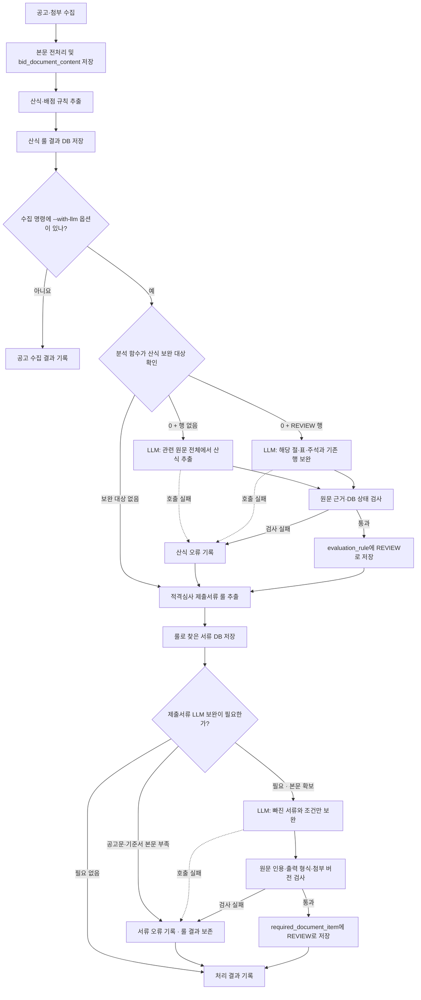

# 공고 분석 LLM 보완 실행 순서

현재 연결 대상은 SQLite `bidmate.sqlite3`다. 아래 명령은 프로젝트 루트에서 실행한다. LLM을 호출할 때는 `.env`의 `OPENAI_API_KEY`와 `OPENAI_MODEL`을 사용한다.

## 전체 흐름



수집 완료와 AI 분석 완료는 별개다. `REVIEW`는 원문 근거나 적용 조건을 추가로 확인해야 한다는 뜻이다.

수집기와 LLM 코드 사이의 호출 조건, 저장 테이블과 상태값은 [LLM 연동 기준](LLM_HANDOFF.md)을 참고한다.

## 수집부터 DB 저장까지 한 번에 실행

```powershell
python -m pip install -r backend/collector/requirements.txt
python -m backend.collector.collect --limit 1 --with-llm
```

수집기가 산식 규칙 결과를 커밋하면 `process_notice_extraction(db, notice_no)`을 호출한다.
이 함수는 실패 산식 LLM 보완·저장 → 제출서류 룰 추출·저장 → 실패 서류 LLM 보완·저장 순서로 실행한다.
산식과 서류의 API 호출은 각각 독립이다. 산식이 실패해도 서류 단계는 이어진다.
`--with-llm`을 붙인 수집 실행에서 OpenAI 유료 호출이 발생할 수 있다.

서류는 적격심사 단계만 대상으로 한다. 명시 목록에서 조건이 단순한 후보는 먼저 저장한다.
후보가 없거나, 별도 제출 안내·복합 조건 등 규칙으로 처리하지 못한 근거가 있으면 LLM이 그 빈 부분을 보완한다.
누락 판정은 현재 룰이 찾은 근거에 기반하므로 모든 누락을 검출한다고 보장할 수 없다.
자동 저장 결과는 `REVIEW`이며, 서류는 원문 문구와 첨부 버전도 저장한다.
같은 버전의 처리가 끝난 서류는 재호출을 건너뛰고, API 오류가 나면 먼저 저장한 룰 결과를 보존한다.
자동 재시도는 아직 연결하지 않았다. 수집 로그에서 공고번호와 산식·서류별 실패 사유를 확인한다.

이미 수집한 공고를 다시 처리할 때는 공고를 재수집하지 않고 아래 명령을 사용한다.

```powershell
python -m ai.notice_extraction --notice 공고번호 --execute
```

아래 개별 명령은 산식 초안을 확인하거나 제출서류를 스테이징 DB로 검토할 때 사용한다.

## 1. 산식·배점 보완

`bid_document_content.rule_extracted=0`인 공고번호를 선택한다. 평가 행이 없으면 전체 관련 본문을 보내고, `REVIEW` 행이 있으면 해당 행 주변과 기존 배점표를 보낸다.

```powershell
python -m ai.llm_evaluation --notice 공고번호
python -m ai.llm_evaluation --notice 공고번호 --execute
python -m ai.llm_evaluation --notice 공고번호 --apply-draft .local/llm-evaluation/출력파일.json
```

두 번째 명령은 유료 호출 후 `.local/llm-evaluation/`에 검토용 JSON을 만든다. 출력된 `review_file` 경로를 세 번째 명령에 넣는다. 세 번째 명령은 API 재호출 없이 `evaluation_rule`에 `updated_by=LLM`, `verification_status=REVIEW`로 저장한다. 원문 근거가 없거나 입력 원문이 바뀌면 저장하지 않는다. 이미지에만 있는 산식·파싱에 실패한 본문은 OCR 또는 원본 판독이 선행돼야 한다.

## 2. 제출서류 규칙 후보 + LLM 보완

```powershell
python -m ai.document_staging ingest-db bidmate.sqlite3
python -m ai.llm_documents --notice 공고번호
python -m ai.llm_documents --notice 공고번호 --execute
python -m ai.document_staging migrate bidmate.sqlite3 --include-review
python -m ai.document_staging migrate bidmate.sqlite3 --include-review --apply
```

`llm_documents`가 해당 공고의 규칙 후보를 먼저 만들고, LLM은 후보와 공고문·기준서 전체를 함께 대조해 누락을 찾는다. 규칙 후보가 있다는 사실만으로 추출 완료를 판정할 수 없으므로, LLM 검증 대상 공고는 별도로 선정해야 한다. `migrate`의 첫 명령은 미리보기이고 `--apply`를 붙여야 `required_document_item`에 저장한다. `--include-review`로 옮긴 항목은 `REVIEW` 상태이며 자동으로 `VERIFIED`가 되지 않는다. 기존 DB 항목과 내용이 충돌하면 덮어쓰지 않고 중단한다.

## 현재 범위

- 수집 연동 명령은 수집기가 사용한 SQLite에 결과를 직접 저장한다. 위 스테이징 명령은 제출서류를 별도로 실험할 때 사용한다.
- 제출서류 LLM에는 읽을 수 있는 공고문과 적격심사기준이 각각 하나 이상 필요하다. 본문이 부족하면 재파싱·OCR 후 재처리한다.
- `REVIEW`는 기계 추출 결과의 검수 상태다. 산식 계산의 정확성과 제출서류 완전성 평가는 전체 연동 이후 진행한다.
