# 입찰메이트 DB 스키마 v1.0 설명서

> 담당: 이정근 (개발팀 · DB 설계) · 2026-11-19  
> 파일: [`schema.sql`](schema.sql) (SQLite) · 기준정보 시드: [`seed_reference.py`](seed_reference.py)  
> 기준 문서: [기능명세서 §5](../../docs/planning/기능명세서.md), [업체정보 데이터 정의서 v0.2](../../docs/planning/업체정보_데이터_정의서.md), 11-18 회의 결정

## 한눈에 보기

테이블 28개 + 뷰 1개를 **6개 영역**으로 나눴다. 각 영역은 **채우는 담당이 한 명**이 되도록 나눴으니, 본인 영역만 쓰고 나머지는 읽기만 하면 된다.

| 영역 | 테이블 | 채우는 쪽 | 읽는 쪽 |
|---|---|---|---|
| **A. 기준정보** | 면허·자격·지역 마스터, 상하위 인정 규칙 | 시드 스크립트 (참고 엑셀) | 업체정보 화면, 룰 엔진 |
| **B. 업체** | `company`, `company_license`, `company_restricted_qualification`, `company_notification_setting` | 업체정보 화면 (프론트 → 백엔드) | 룰 엔진, 알림 |
| **C. 공고 수집** | `bid_notice`, `bid_restriction_*`, `bid_attachment`, `bid_document_content`, `collect_run` | 수집기 `backend/collector` (정근) | 전원 |
| **D. 문서 분석** | `notice_analysis_cache`, `document_extraction` | **AI 파트 (용희)** | 요약 탭, 룰 엔진 |
| **E. 판정·점수** | `company_bid_eligibility`, `evaluation_rule`, `company_evaluation_draft` | 룰 엔진 (정근) · `evaluation_rule`은 AI 추출값 기반 | 추천 목록, 점수 계산 탭 |
| **F. 서류·사용자 작업·알림** | `required_document_item`, `document_template_item`, `company_document_check`, `favorite_notice`, `notice_schedule_event`, `notice_notification` | 서류: AI 추출 / 체크·별표: 화면 / 알림: 알림 발송 | 필요서류 탭, 달력, 알림 |

```mermaid
erDiagram
    company ||--o{ company_license : 보유
    company ||--o{ company_restricted_qualification : 보유
    company ||--o| company_notification_setting : 알림설정
    license_master ||--o{ company_license : ""
    restricted_qualification_master ||--o{ company_restricted_qualification : ""
    srm_region_group_master ||--o{ srm_region_district_master : ""
    srm_region_district_master ||--o{ company : 본점소재지

    bid_notice ||--o| bid_restriction_snapshot : 자동심사설정
    bid_notice ||--o{ bid_restriction_category : 범주별조회결과
    bid_notice ||--o{ bid_restriction_item : 면허자격명_적격자격명_지역
    bid_notice ||--o{ bid_attachment : 공고문_적격심사기준
    bid_attachment ||--o| bid_document_content : 원문텍스트_수식

    bid_notice ||--o| notice_analysis_cache : AI분석상태
    bid_notice ||--o{ document_extraction : AI추출값
    bid_notice ||--o{ evaluation_rule : 배점_산식
    bid_notice ||--o{ required_document_item : 필요서류
    bid_notice ||--o{ notice_schedule_event : 일정

    company ||--o{ company_bid_eligibility : 판정
    bid_notice ||--o{ company_bid_eligibility : ""
    company ||--o{ company_evaluation_draft : 점수시뮬레이션
    company ||--o{ company_document_check : 서류체크
    required_document_item ||--o{ company_document_check : ""
    company ||--o{ favorite_notice : 관심공고
    company ||--o{ notice_notification : 알림이력
```



## 화면별로 어떤 테이블을 쓰나

| 화면 (기능명세서) | 읽는 테이블 | 쓰는 테이블 |
|---|---|---|
| 업체정보 입력 (UI-02) | `license_master`, `restricted_qualification_master`, `srm_region_*` | `company`, `company_license`, `company_restricted_qualification` |
| 추천 공고 목록 (UI-01) | **`v_recommendation`** (진행 중 공사용역 공고 + 판정 + 별표) | `favorite_notice` |
| 요약 탭 (UI-03) | `bid_restriction_item`(자동심사 조건), `document_extraction`, `evaluation_rule` | — |
| 점수 계산 탭 (UI-04) | `evaluation_rule`, `bid_notice.a_amount`·`approximate_amount` | `company_evaluation_draft` |
| 필요서류 탭 (UI-05) | `required_document_item` | `company_document_check` |
| 관심공고 달력 (UI-06) | `notice_schedule_event` | `favorite_notice` |
| 알림 설정 (UI-07) | — | `company_notification_setting`, `notice_notification` |

## 팀 결정 → 컬럼 대응

| 팀 결정 (기획 정리) | 저장 위치 |
|---|---|
| 공사용역만 (`purchaseType=ConstructionService`), 한전만 (`companyId=COM01`) | `bid_notice.purchase_type`, `company_id_src` — 수집기가 자재구매 공고는 저장하지 않음 |
| 진행 중 공고만 | `bid_notice.is_open` + **입찰참가신청 마감 일시** (아래 주의 1) |
| 예비가격 기초금액 (`estimatedPriceBasicAmount`) | `bid_notice.estimated_price_basic_amount` |
| 추정가격 (`presumedPrice`, VAT 제외) | `bid_notice.presumed_price` |
| 사정액 (`approximateAmount`) | `bid_notice.approximate_amount` |
| A금액 (웹 `totalAAmt`) | `bid_notice.a_amount` — SRM 상세 조회에 포함, 추가 요청 없음 |
| 순공사원가 (웹 `overHeadCostAmount`) | `bid_notice.net_construction_cost` |
| 자동심사 조건: 면허자격명 / 적격자격명 | `bid_restriction_item` (`category` = `LICENSE` / `QUALIFIED` / `REGION` / `LICENSE_MAIN`) |
| 공고문 → 입찰참가자격, 증명 서류 | `document_extraction` (field), `required_document_item` (`stage=ELIGIBILITY`) |
| 적격심사기준 → 배점표, 입찰가격 산식, 해당/인접 사업소, 업종별 경영상태 평균비율 | `evaluation_rule` (`category` = `PRICE` / `PERFORMANCE` / `OFFICE` / `MANAGEMENT` …, 세부는 `parameters` JSON) |
| 적격심사 제출서류 (계약부서 / 감독부서, "2가지 중 1가지") | `required_document_item.stage`, `submit_to`, `alternative_group` |
| 공고유형별 대표 제출서류 목록 (정리본 1~7번) | `document_template_item` (`work_type` + 추정가격 구간) |
| 감리 상위 면허 자동 통과 (전력종합감리 → 전력전문감리) | `license_equivalence` |
| 제출기한: 개찰 후 통보서 접수일로부터 5일 이상 (적격심사기준 제8조 ②) | `notice_schedule_event` `QUALIFICATION_DOC_DUE`, 개찰 전엔 `confirmed=0`(참고 일정) |

## 꼭 알아야 할 규칙

1. **"진행 중"은 `progressState`만 믿으면 안 된다.** Open API에서 공사용역 1,092건이 전부 `AttendProgress`였고, 그중 904건은 입찰참가신청 마감이 이미 지났다. `v_recommendation`과 수집기는 **마감 일시도 함께** 확인한다.
2. **코드는 전부 문자열.** 면허 `0041`, 자격 `1`, 시군구 `011013`처럼 앞자리 0이 의미가 있다. 참고 엑셀 `지역제한 목록.xlsx`는 시군구 코드 162건이 숫자로 저장돼 0이 빠져 있어(`11013`), 시드할 때 6자리로 복원한다.
3. **조회 실패 ≠ 제한 없음.** `bid_restriction_category.fetch_status='SUCCESS'`이고 `item_count=0`일 때만 "제한 없음(`NOT_APPLICABLE`)". 실패면 판정은 `REVIEW`.
4. **업체 지역은 (광역, 시군구) 쌍으로 검증.** `company`의 `(area_limit, sub_area_code)`가 기준정보에 없는 조합이면 저장 자체가 막힌다(예: 강원 + 가평군).
5. **상태값은 정해진 값만.** `MATCH/MISMATCH/REVIEW/NOT_APPLICABLE` 등은 CHECK 제약으로 막혀 있어 오타가 들어가면 저장 오류가 난다.
6. **개인정보 미저장.** SRM 응답의 한전 담당자 이름·사번·연락처는 저장 전에 제거한다. 업체 정보는 가상 데이터만 사용한다.
7. **금액은 원 단위 정수, 일시는 문자열(KST).** Open API 일시는 `YYYY-MM-DD HH:MM:SS` 그대로 저장한다.

## AI 파트 (용희) 연결 지점

- **입력:** `bid_document_content.text`(본문), `equations`(한글 수식 스크립트 JSON) — 공고문/적격심사기준 구분은 `bid_attachment.doc_kind`.
- **출력:** `document_extraction`(필드·값·근거·검증상태), `evaluation_rule`(배점·산식·파라미터), `required_document_item`(서류 목록), 분석 상태는 `notice_analysis_cache`.
- `field` 이름, `parameters` JSON 형식, 서류 `stage` 분류 기준은 **함께 정하자** — 스키마는 저장 구조만 고정했다.

## 초기화

```bash
python -m backend.db.seed_reference --db bidmate.sqlite3       # 스키마 생성 + 기준정보(면허 3,629 / 자격 20 / 지역 18그룹·253시군구)
python -m backend.collector.collect --db bidmate.sqlite3 --days 7 --limit 5   # 공고 수집 (요구: .env SRM_API_KEY)
```

`bidmate.sqlite3`는 `.gitignore`로 제외된다. 연결마다 `PRAGMA foreign_keys = ON`을 먼저 실행한다.

## 검증 (2026-11-19)

- 스키마 적용 `integrity_check=ok`, 외래키 위반 0건, 테이블 28개·뷰 1개
- 차단 확인: 없는 시군구, 광역과 맞지 않는 시군구, 사업자번호 형식 오류, 없는 면허코드, 같은 면허 중복, 판정 상태 오타
- 실제 공고 E012607925 수집 → 면허 A06·지역 I, 사정액 503,486,765, A금액 27,323,919, 순공사원가 137,863,291, 개찰 11-12 15:00 저장
- `v_recommendation`: 마감 지난 공고 제외, 마감 전 공고만 표시

## 아직 정하지 않은 것

- `work_type`(공고유형) 분류 규칙 — 대표 공고 정리본 기준으로 공고명·면허·금액으로 분류할지 기획과 협의
- `document_template_item` 시드 (정리본 1~7번 입력) — 형식 확정 후 추가
- 다중 사용자(`company_user`)는 후속 (정의서 §9)
- 운영 DB를 PostgreSQL로 옮길지 (기획서 5장 제안) — SQLite 문법만 사용해 전환 비용을 줄였다

> 이전 `schema.sql`(P0 데모용 `notices`, `company_profiles` 등)은 이 버전으로 대체했다. `/api/demo`는 여전히 `data/sample/demo.json`을 읽으므로 데모 동작에는 영향이 없다.
