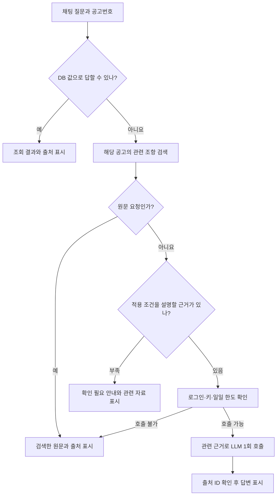

# 입찰메이트 챗봇의 공고 검색과 LLM 답변

기존 React의 **AI 질문** 패널을 `POST /api/qna`에 연결했다. 공고 상세에서 질문하면 해당 공고번호로 조회 범위를 고정한다. 백엔드는 기존 SQLite의 공고·심사 데이터를 조회하고, 필요한 경우 공고문과 적격심사기준의 관련 조항을 검색한다.

## 질문 처리 순서



| 질문 | 처리 방식 | LLM 호출 |
| --- | --- | ---: |
| A값, 통과점수, 투찰제한·면허·지역 조회 | DB에서 조회한 값과 출처를 표시한다. 통과점수가 검수 전이면 상태를 표시한다. | 0 |
| 검수된 개별 서류의 제출 조건 | DB에서 명확히 일치하는 항목이 하나라면 저장된 제출 조건을 보여준다. 복합 대체 관계는 조항을 확인한다. | 0 |
| “특허증 원문 보여줘” | 관련 조항을 검색해 원문과 출처를 표시한다. | 0 |
| “전에 낸 실적증명서를 다시 내야 해?” | 재제출 조항이 검색되면 그 근거를 보내 설명한다. 근거가 부족하면 관련 자료와 확인 안내를 표시한다. | 0 또는 1 |
| 공고 목록·업체별 참가 질문 | 기존 React 답변 기능으로 넘긴다. | 0 |

## 검색 데이터와 갱신

- 공고 기본값은 `bid_notice`, 투찰제한은 `bid_restriction_*`, 평가산식은 `evaluation_rule`, 추출된 제출서류는 `required_document_item`에서 조회한다.
- 공고문과 적격심사기준의 읽을 수 있는 본문을 조항 단위로 나눠 `rag_chunk`에 저장한다. `rag_document`에 첨부별 버전을, `rag_chunk_fts`에 SQLite FTS5 검색 인덱스를 둔다. 검색 결과는 한 번에 최대 세 조각을 사용한다.
- 기존 본문은 `python -m ai.rag_index`로 미리 적재할 수 있다. 질문이 들어오면 해당 공고의 본문 버전을 확인해 바뀐 첨부만 갱신한다. 정정 재수집 대기 중에는 최신 원문을 기다리도록 안내한다.
- 챗봇의 근거 제목을 누르면 DB 조회값 또는 원문 조각이 펼쳐진다. LLM 답변의 출처 ID는 서버에서 실제 제공한 근거와 대조한다.

## 로컬 확인

```powershell
# 백엔드 터미널
python -m pip install -r backend/collector/requirements.txt
$env:BIDMATE_DB = '수집 DB 복사본의 절대 경로'
$env:QNA_DAILY_LLM_LIMIT = '0'
python -m ai.rag_index
python -m backend.server --port 8000

# React 터미널
cd frontend-react
npm ci
$env:BIDMATE_API = 'http://127.0.0.1:8000'
npm run dev
```

개발 서버에서 공고 상세를 연 뒤 오른쪽 아래 **AI 질문**을 사용한다. SQLite는 FTS5의 `trigram`을 지원해야 한다. 유료 해석을 확인하려면 백엔드에 `OPENAI_API_KEY`와 `OPENAI_MODEL`을 설정하고 로그인한다. 서버 전체 한도는 하루 최대 10회(한국 시간)다. `QNA_DAILY_LLM_LIMIT`으로 더 낮출 수 있으며, `0`은 검색 전용이다. 같은 사용자의 같은 질문과 근거는 서버가 실행 중인 동안 메모리에서 재사용하며, 한도는 실제 API 호출 시도에만 적용된다.

## 검증 결과

- 팀 공유 DB 복사본에서 공고 229건의 본문 464개를 색인했다. 공유 DB의 `required_document_item`은 비어 있어 실제 서류 질문은 원문 검색으로 확인했고, 검수된 서류의 DB 직접 조회는 테스트 행으로 확인했다.
- `E012608273`에서 면허·지역 조회와 특허증 원문 요청은 호출 0회였다. 재제출 질문은 `E012607010`에서 관련 조항을 찾아 모의 API 1회를 호출했고, `E012608273`에서는 관련 조항이 검색되지 않아 호출 0회였다.
- 로컬 채팅 API와 근거 데이터 반환, 관련 테스트 18개, React 빌드를 확인했다. 실제 유료 API 답변의 정확도와 배포 서버 동작은 후속 검증 대상이다.
